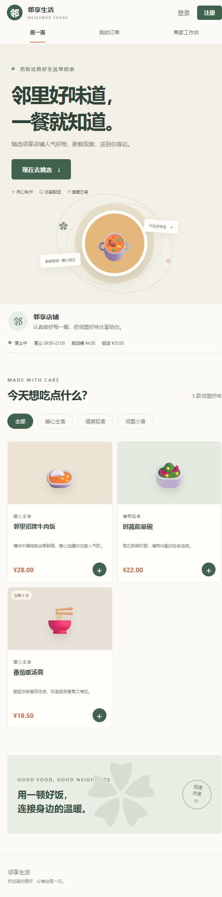
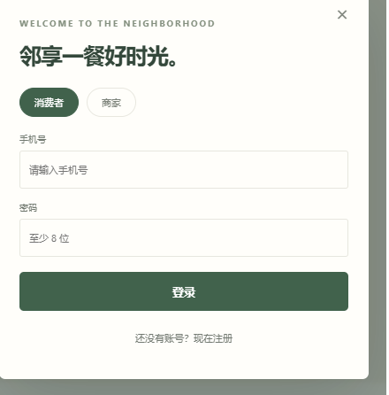
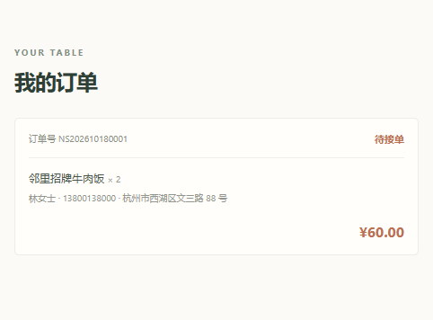
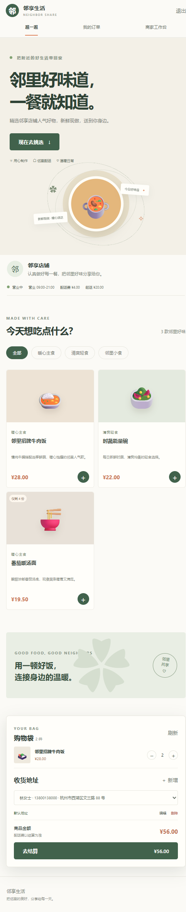
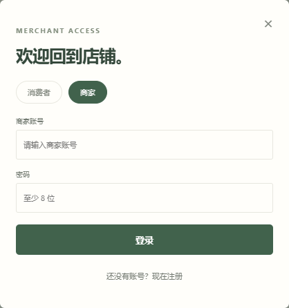
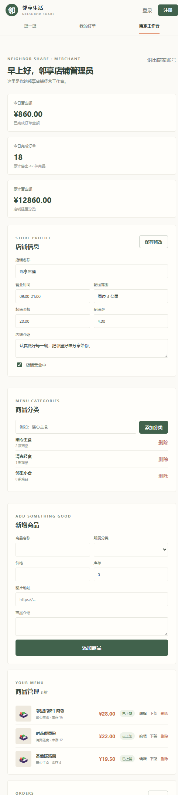

# 邻享生活 NeighborShare

邻享生活是一个单店零售与配送应用，包含消费者页面、商家工作台和 FastAPI 后端。消费者可以选购商品、管理地址和订单、领取优惠券及参加限量秒杀；商家可以维护商品、订单、优惠券和秒杀活动。

前端使用 Vue 3、TypeScript 和 Vite；后端使用 FastAPI、SQLAlchemy 异步 ORM 和 MySQL 或 SQLite。接口路径、参数和业务规则见[后端业务接口说明](./后端业务接口.md)。

## 功能

### 消费者

- 浏览店铺、商品分类、上架商品、可领取优惠券和秒杀活动。
- 注册、登录，管理购物车、收货地址和订单。
- 领取本人限额内的优惠券，在结算时使用一张符合门槛的立减券。
- 在活动时间内按库存和每人限购数量参加秒杀；成功后创建待支付订单。
- 取消待支付订单时，商品库存和秒杀名额会退回；已使用的优惠券也会恢复（若仍在有效期内）。

### 商家

- 管理店铺资料、商品分类、商品和订单。
- 创建、调整和停用优惠券；查看发行量及已领取数量。
- 创建、编辑、启用或停止秒杀活动；设置商品、秒杀价、活动库存、时间范围和每人限购数。
- 查看经营概览和商品销售排行。

## 优惠券与秒杀规则

- 优惠券采用固定金额立减，支持最低商品金额、总发行量、每人领取上限和有效期；每张订单只能使用一张。
- 店铺起送金额按优惠前的商品金额判断。优惠额不会超过商品金额，配送费不参与折扣。
- 停用优惠券会停止继续领取；已领到的券仍可在有效期内使用。优惠券已有领取记录后，面额、门槛和有效期不可修改。
- 秒杀订单不与优惠券叠加。秒杀成功后立即创建普通订单状态机中的“待支付”订单，不代表支付成功。
- 抢券和秒杀库存使用数据库条件更新及事务处理，限制数量、用户领取/购买上限和订单库存变化在数据库内校验；业务不依赖 Redis 或消息队列。
- 生产环境当前没有接入真实支付渠道，也没有未支付订单的自动超时关单任务。模拟支付仅用于显式开启的开发环境。

## 项目结构

```text
NeighborShare/
├── backend/
│   ├── app/
│   │   ├── common/       # 统一响应和异常处理
│   │   ├── db/migrations/# MySQL 与 SQLite SQL 迁移
│   │   ├── dependencies/ # 消费者和商家鉴权
│   │   ├── models/       # 数据模型
│   │   ├── routers/      # HTTP 接口
│   │   ├── schemas/      # 请求与响应校验
│   │   └── services/     # 订单、优惠券、秒杀等业务逻辑
│   ├── tests/            # API 集成测试
│   ├── .env.example
│   ├── main.py
│   └── pyproject.toml
├── frontend/
│   ├── src/App.vue       # 消费者页面和商家工作台
│   ├── src/api/          # HTTP 客户端
│   ├── src/types/        # API 数据类型
│   └── package.json
├── pictures/             # 页面截图
├── readme.md
└── 后端业务接口.md
```

## 本地运行

需要 Python 3.13 或更新版本、[uv](https://docs.astral.sh/uv/)、Node.js `^22.18.0` 或 `>=24.12.0` 及 npm。SQLite 可用于本地体验；部署或多人开发建议使用 MySQL。

### 启动后端

在 PowerShell 中：

```powershell
Set-Location .\backend
Copy-Item .env.example .env
```

编辑 `backend/.env`，设置数据库连接和随机 JWT 密钥。SQLite 示例：

```dotenv
DATABASE_URL=sqlite+aiosqlite:///./neighborshare.db
JWT_SECRET_KEY=替换为长且随机的本地密钥
APP_ENV=development
ENABLE_SIMULATED_PAYMENTS=false
```

安装依赖并启动：

```powershell
uv sync --dev
uv run uvicorn main:app --reload --host 127.0.0.1 --port 8000
```

API 文档地址：<http://127.0.0.1:8000/docs>。

### 启动前端

另开一个 PowerShell 窗口：

```powershell
Set-Location .\frontend
npm ci
npm run dev
```

打开 Vite 输出的地址，通常是 <http://127.0.0.1:5173>。开发代理默认指向 `http://127.0.0.1:8000`；需要更改时，在 `frontend/.env.local` 中设置 `VITE_API_PROXY_TARGET`。

## 数据库更新

新建数据库首次启动时，应用会按模型创建数据表。`Base.metadata.create_all` 不会修改已存在的表结构；升级已有数据库前先备份，并按数据库类型执行：

- MySQL：`backend/app/db/migrations/009_create_coupons_and_seckill.sql`
- SQLite：`backend/app/db/migrations/009_create_coupons_and_seckill_sqlite.sql`

这些脚本仅用于已经有旧版 NeighborShare 表结构的数据库，不要在首次创建的数据库上重复执行。应用启动后可通过商家工作台创建优惠券和秒杀活动。

## API 概览

消费者优惠券和秒杀接口：

| 方法 | 路径 | 用途 |
| --- | --- | --- |
| `GET` | `/api/coupons` | 查询当前可领取优惠券 |
| `POST` | `/api/coupons/{coupon_id}/claim` | 领取优惠券 |
| `GET` | `/api/users/me/coupons` | 查询本人优惠券；可用 `status=available\|used\|expired` 筛选 |
| `GET` | `/api/seckill/activities` | 查询即将开始和进行中的活动 |
| `GET` | `/api/seckill/activities/{activity_id}` | 查询活动及剩余名额 |
| `POST` | `/api/seckill/activities/{activity_id}/orders` | 秒杀下单，提交 `address_id` 和 `quantity` |
| `POST` | `/api/orders` | 普通购物车下单；可选提交 `user_coupon_id` |

商家管理接口位于 `/api/admin/coupons` 和 `/api/admin/seckill/activities` 下。非公开操作均需对应的消费者或商家 Bearer Token。所有接口统一使用 `{code, message, data}` 响应；金额由服务端计算。

## 检查

在 `backend` 目录运行后端测试：

```powershell
uv run pytest -q
```

在 `frontend` 目录运行类型检查和生产构建：

```powershell
npm run build
```

## 预览图

截图用于展示页面布局，不代表线上交易数据。

## 界面预览

### 消费者首页



### 消费者登录和订单

| 消费者登录 | 我的订单 |
| --- | --- |
|  |  |

### 购物车与收货地址



### 商家入口与管理工作台

| 商家登录 | 商家工作台 |
| --- | --- |
|  |  |
